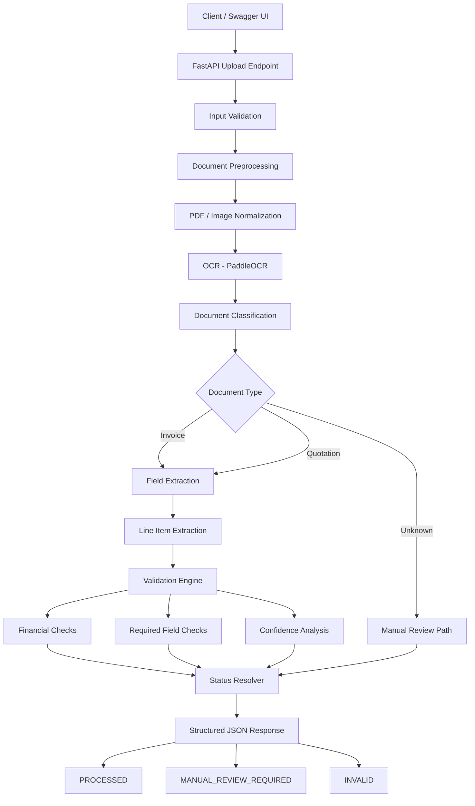

# Intelligent Invoice / Quotation Understanding Engine

A FastAPI-based document understanding service that processes invoices and quotations from PDF and image files, extracts structured business information, validates financial consistency, calculates confidence scores, and returns structured JSON output.

## Overview

The system accepts invoice and quotation documents in PDF, JPG, JPEG, and PNG formats and processes them through the following pipeline:

Upload → Preprocessing → OCR / Text Extraction → Document Classification → Field Extraction → Validation → Confidence Scoring → Structured Output

The engine is designed to support multiple document layouts without relying on fixed coordinates or filename-based classification.

## Core Features

- PDF and image document upload
- Image preprocessing for scanned, rotated, and low-quality documents
- OCR-based text extraction using PaddleOCR
- Invoice, Quotation, and Unknown classification
- Structured field extraction
- Line-item extraction
- Financial validation
- Confidence scoring
- Manual-review detection
- Controlled handling of unsupported or corrupt files
- FastAPI REST API
- Swagger / OpenAPI documentation
- Docker support

## Extracted Information

The system can extract fields such as:

- Document number
- Document date
- Vendor / company name
- Customer name
- Address
- Currency
- Subtotal
- Discount
- Tax
- Additional charges
- Grand total

For line items, the engine can extract:

- Description
- Quantity
- Unit price
- Line total

## Document Classification

Documents are classified as:

- `INVOICE`
- `QUOTATION`
- `UNKNOWN`

Classification uses document content and structural signals rather than relying on a single keyword or filename.

If the system does not have enough confidence to classify a document, it remains `UNKNOWN` instead of forcing an invoice or quotation classification.

## Validation Status

Each analyzed document receives one of the following statuses:

- `PROCESSED`
- `MANUAL_REVIEW_REQUIRED`
- `INVALID`

The validation layer checks for missing required fields, inconsistent totals, incorrect line-item calculations, currency conflicts, low-confidence extraction, and other document-quality issues.

## Technology Stack

- Python 3.11
- FastAPI
- PaddleOCR
- PaddlePaddle
- OpenCV
- PyMuPDF
- Pydantic
- Pytest
- Uvicorn
- Docker

## Project Structure

```text
Intelligent-Document-Engine/
├── app/
│   ├── api/
│   ├── core/
│   ├── models/
│   ├── services/
│   │   ├── classification/
│   │   ├── extraction/
│   │   ├── ocr/
│   │   ├── preprocessing/
│   │   └── validation/
│   └── main.py
├── scripts/
├── samples/
├── tests/
├── Dockerfile
├── .dockerignore
├── requirements.txt
├── pyproject.toml
└── README.md
```

## Local Setup

### 1. Clone the repository

```bash
git clone <repository-url>
cd Intelligent-Document-Engine
```

Replace `<repository-url>` with the actual Git repository URL.

### 2. Create a virtual environment

```bash
python -m venv .venv
```

Activate the virtual environment on Windows PowerShell:

```powershell
.venv\Scripts\Activate.ps1
```

### 3. Install dependencies

```bash
python -m pip install --upgrade pip
pip install -r requirements.txt
```

### 4. Run the FastAPI application

```bash
uvicorn app.main:app --host 0.0.0.0 --port 8000
```

The API will be available at:

```text
http://127.0.0.1:8000
```

Swagger API documentation:

```text
http://127.0.0.1:8000/docs
```

Health check:

```text
http://127.0.0.1:8000/health
```

## Docker Setup

Make sure Docker Desktop or Docker Engine is running.

### 1. Build the Docker image

```bash
docker build -t intelligent-document-engine .
```

### 2. Run the container

```bash
docker run --rm -p 8000:8000 intelligent-document-engine
```

### 3. Open the API documentation

```text
http://127.0.0.1:8000/docs
```

Health endpoint:

```text
http://127.0.0.1:8000/health
```

The first OCR request may take longer because OCR models may need to be initialized or downloaded.

## API Usage

The main document analysis endpoint is:

```text
POST /api/documents/analyze
```

Supported file formats:

- PDF
- JPG
- JPEG
- PNG

To test the endpoint:

1. Open `http://127.0.0.1:8000/docs`
2. Select `POST /api/documents/analyze`
3. Click `Try it out`
4. Upload an invoice or quotation
5. Click `Execute`
6. Review the structured JSON response

## Example Response

```json
{
  "document_type": "INVOICE",
  "confidence": 0.88,
  "fields": {
    "document_number": {
      "value": "US-001",
      "confidence": 0.89
    },
    "document_date": {
      "value": "11/02/2019",
      "confidence": 0.64
    },
    "vendor_name": {
      "value": "East Repair inc.",
      "confidence": 0.91
    },
    "currency": {
      "value": "$",
      "confidence": 0.90
    },
    "subtotal": {
      "value": 145.00,
      "confidence": 0.95
    },
    "tax": {
      "value": 9.06,
      "confidence": 0.95
    },
    "grand_total": {
      "value": 154.06,
      "confidence": 0.95
    }
  },
  "line_items": [
    {
      "description": "Front and rear brake cables",
      "quantity": 1,
      "unit_price": 100,
      "line_total": 100,
      "confidence": 0.98
    }
  ],
  "validation_issues": [],
  "status": "PROCESSED"
}
```

## Running Tests

Run the complete test suite with:

```bash
pytest -v
```

The project includes tests for:

- Upload validation
- Supported and unsupported file types
- Corrupt file handling
- Image preprocessing
- PDF preprocessing
- OCR integration
- Invoice classification
- Quotation classification
- Unknown document classification
- Field extraction
- Line-item extraction
- Missing required fields
- Incorrect totals
- Low-confidence OCR
- Rotated documents
- Low-resolution documents
- FastAPI endpoints

## Sample Test Scenarios

The project includes sample documents covering different situations such as:

- Standard invoice
- Different-layout invoice
- Quotation layouts
- Rotated invoice
- Low-resolution invoice
- Blurred invoice
- Missing document number
- Missing document date
- Missing total
- Incorrect grand total
- Unsupported or unrelated business documents

These scenarios are used to verify that the system does not silently accept unreliable results.

## Error Handling

The API handles invalid inputs safely and returns controlled errors for situations such as:

- Unsupported file types
- Corrupt files
- Empty uploads
- OCR failures
- Invalid document content

The system avoids inventing missing values and surfaces uncertain or inconsistent results for manual review.

## Confidence and Manual Review

Each extracted field contains a confidence score.

Documents are marked as `MANUAL_REVIEW_REQUIRED` when the system detects situations such as:

- Missing required fields
- Low OCR confidence
- Low classification confidence
- Invalid calculations
- Grand-total mismatches
- Other extraction inconsistencies

Unknown documents are not forced into Invoice or Quotation categories.

## Known Limitations

- OCR accuracy depends on document quality.
- Very complex or heavily stylized layouts may reduce extraction accuracy.
- Handwritten documents are not a primary target.
- Currency symbols may be unavailable when OCR does not detect them reliably.
- Duplicate-document detection is not persisted across application restarts.
- The system is designed as a prototype document-understanding engine rather than a full ERP or accounting platform.

## Architecture

The system follows a modular processing pipeline:

```text
Client
  |
  v
FastAPI Upload Endpoint
  |
  v
Input Validation
  |
  v
Document Preprocessing
  |
  v
OCR / Text Extraction
  |
  v
Document Classification
  |
  v
Field + Line Item Extraction
  |
  v
Validation
  |
  v
Confidence Scoring
  |
  v
Structured JSON Response
```



## Final Demo Flow

A recommended demonstration includes:

1. Analyze a valid invoice and show `PROCESSED`.
2. Analyze a quotation with a different layout.
3. Analyze a rotated or low-quality document.
4. Analyze a document with an intentionally incorrect total.
5. Analyze a document with missing required information.
6. Analyze an unrelated document and show `UNKNOWN` with manual review.
7. Show the Swagger API documentation.
8. Show the structured JSON response returned by the API.

## Security and Safety

- No secrets are stored in source code.
- File uploads are validated before processing.
- Unsupported and corrupt files are handled with controlled errors.
- Missing values are not fabricated.
- Financial inconsistencies are surfaced through validation issues.
- Unknown documents remain `UNKNOWN` when classification confidence is insufficient.

## License

This project was developed as part of an AI/ML internship task for demonstration and evaluation purposes.